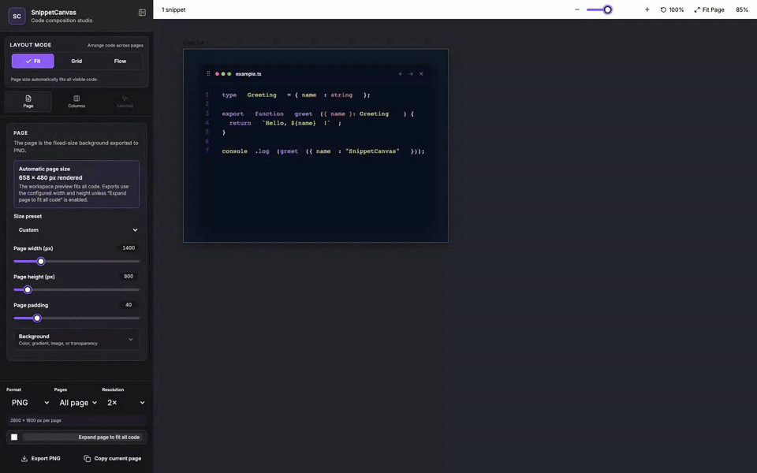

# SnippetCanvas

Create polished, publication-ready code compositions without leaving VS Code.

SnippetCanvas lets you collect selected code or complete files, arrange independent snippets across resizable columns and multiple fixed-size pages, style the result, and export it as PNG, JPEG, SVG, or PDF.

The walkthrough above shows the core workflow: choose a layout, apply a style preset, customize an individual code column, configure the export, and review the finished canvas.

## Highlights

- Capture the current selection or an entire file.
- Combine snippets from multiple files without merging their code or line numbers.
- Arrange code using Fit, Grid, or Flow layouts.
- Resize individual columns from the left, right, bottom, or corner.
- Continue long snippets across columns and pages without hiding code.
- Use US Letter, A4, or custom page dimensions.
- Apply presets, syntax themes, coding fonts, shadows, frames, gradients, captions, watermarks, icons, and tilt.
- Override global styling for one selected column.
- Export one column, the current page, or every page.
- Export PNG, JPEG, SVG, or multi-page PDF at up to 4× resolution.
- Prevent export when code is clipped or unreadable.

## Getting started

1. Open a code file in VS Code.
2. Select the code you want to capture, or leave the selection empty to work with the complete file.
3. Right-click in the editor and open the **SnippetCanvas** submenu.
4. Choose **Add Selection** or **Add Entire File**.
5. Run **SnippetCanvas: Open Composer** from the Command Palette.
6. Arrange and style the page, then choose an export format.

Captured snippets also appear in the SnippetCanvas Activity Bar view, where you can inspect, rename, reorder, and delete them.

### A quick first composition

1. Add two or three selections from the editor so each becomes its own code column.
2. Open the composer and try **Fit** to keep snippets intact, **Grid** for a structured arrangement, or **Flow** for content-aware widths.
3. Apply a style preset, then select any column to give it a custom title, highlighted lines, or independent styling.
4. Set the output format and resolution in the **Page** panel.
5. Resolve any clipping warning, then export the current page or the complete document.

## Pages and columns

A **Page** is the fixed-size artwork that SnippetCanvas exports. It behaves like an Illustrator artboard.

A **Column** is a code panel contained by a page. Columns can have independent dimensions and appearance overrides, but they remain constrained by the available page area.

Long code can continue into additional columns or pages while retaining its original line numbers. Separate source snippets always remain separate.

## Layout modes

### Fit

Keeps each source snippet intact and automatically sizes the live and exported page to display every line and the longest code line. The page is identified as Custom while width, height, and preset controls remain available as composition constraints.

### Grid

Uses **Maximum columns per row** as an upper limit. Columns wrap when the next panel cannot fit. Changing the maximum provides an initial equal-width layout, after which each column remains independently resizable.

### Flow

Uses content-aware column widths and places as many columns as fit in each row. Remaining row space is distributed across the columns in that row.

## Styling

Start with Midnight, Dracula, Nord, or Paper presets, then customize:

- Syntax theme and language
- Bundled coding font or Google Font family
- Font size, line height, indentation, and alignment
- Internal padding and corner radius
- macOS, minimal, terminal, or frameless window styles
- Shadow position, blur, spread, opacity, and color
- Solid or gradient paint with alpha transparency, plus image page backgrounds
- Editable titles and title typography
- Emphasized lines using values such as `3, 5-8`
- Captions, watermarks, icons, emoji, and tilt

Global column settings affect every inherited column. Select a column to override those values only for that panel, or reset it to the global defaults.

## Exporting

SnippetCanvas supports:

- PNG
- JPEG with quality control
- SVG
- Multi-page PDF
- Copy current page as an image
- Export selected column as PNG from its context menu

Before exporting, SnippetCanvas checks the selected scope for clipped code. If a line or snippet does not fit, the composer identifies the affected page and column so it can be corrected. Workspace selection outlines, resize handles, context menus, and editor-only controls are excluded from exported artwork.

## Workspace controls

- Zoom from 10% to 200%.
- Fit the current page to the workspace.
- Return to 100% zoom.
- Pan with Space-drag or the middle mouse button.
- Zoom around the cursor with Ctrl/Cmd-wheel.
- Use `+`, `-`, `0`, and `1` keyboard shortcuts.
- Collapse the settings sidebar for a distraction-free workspace.

## Commands

- **SnippetCanvas: Add Selection**
- **SnippetCanvas: Add Entire File**
- **SnippetCanvas: Open Composer**
- **SnippetCanvas: Clear Snippets**

Editor commands are grouped under the **SnippetCanvas** context submenu.

## Settings

Open VS Code Settings and search for `SnippetCanvas` to configure defaults for:

- Layout mode, maximum columns, and gaps
- Page size, padding, and background
- Column dimensions and typography
- Optional proportional font scaling while resizing columns
- Syntax themes and colors
- Window frames, shadows, and titles
- Decorations and appearance

Use `snippetCanvas.mode` to select the default layout for new composer documents. The default is `fit`.

Enable `snippetCanvas.column.scaleFontOnResize` to shrink or grow a column's code font proportionally when resizing the column with its edge or corner handles. It is disabled by default.

Composer changes are saved per workspace so your pages and snippet arrangement are restored when the composer is reopened.

## Requirements

- VS Code 1.90 or newer

## Privacy

SnippetCanvas composes and exports code locally. A network connection is needed only when you explicitly enter a Google Fonts family that is not bundled with the extension.

### Google Fonts family bundled with the extension
